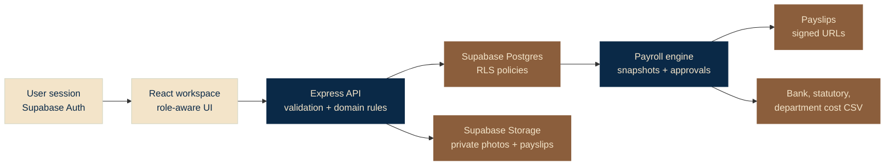
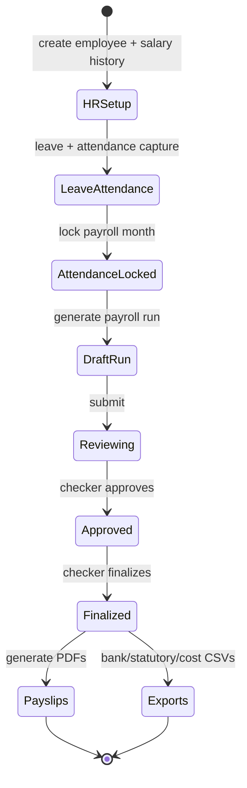
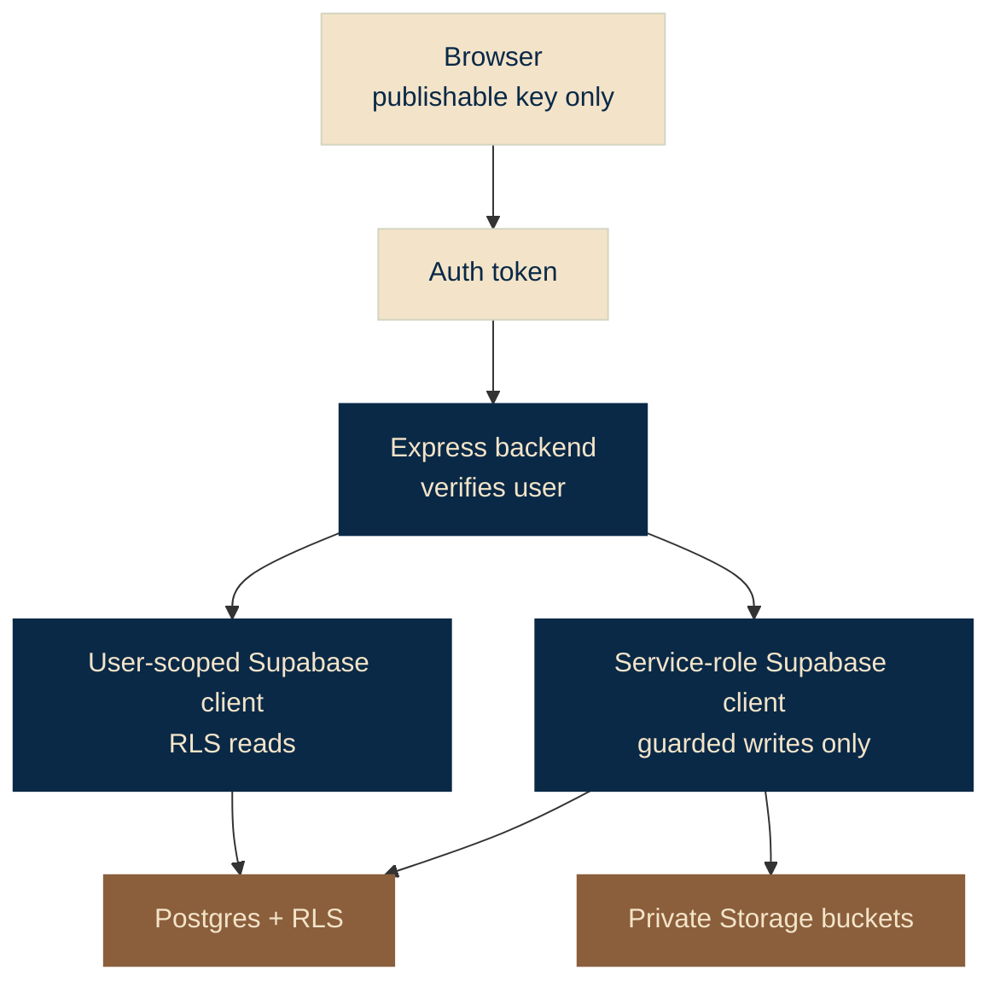
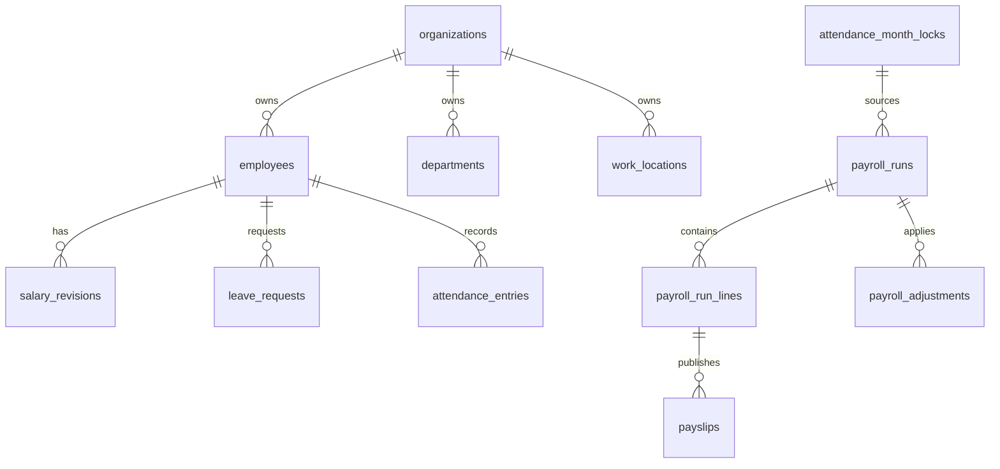

<p align="center">
  
</p>

<h1 align="center">VetanFlow</h1>

<p align="center">
  India-first payroll operations system built with React, Express, and Supabase.
  It covers the month-end path from employee setup and attendance locks to payroll approval, payslip delivery, and finance exports.
</p>

<p align="center">
  
  
  
  
</p>

## The Product

VetanFlow is a payroll control room for an Indian company. The app treats payroll as an auditable monthly workflow, not a salary calculator on a pretty screen.

It models the pieces a serious HR and finance team expects:

- employees, departments, locations, salary history, bank readiness, and private ID photos
- role-aware workspaces for owner, admin, HR, finance, manager, and employee users
- employee self-service with digital ID card, leave requests, and payslip archive
- leave review, escalation metadata, attendance entries, holidays, and locked payroll months
- payroll runs generated only from locked attendance months
- earnings, deductions, reimbursements, overtime, LOP, PF, ESI, PT, and TDS-ready snapshots
- maker-checker approval so the payroll maker cannot approve or finalize the same run
- immutable finalized payroll runs, generated payslip PDFs, signed downloads, and CSV exports

## Screenshots

| Owner payroll review | Employee self-service |
| --- | --- |
|  |  |

| Sign in | Mobile employee view |
| --- | --- |
|  |  |

## System In One View



## Payroll Lifecycle



## Feature Map

| Area | What exists |
| --- | --- |
| Auth and roles | Supabase Auth, backend Bearer-token verification, server-side role lookup, owner/admin/HR/finance/manager/employee permissions |
| HR master data | employees, departments, work locations, salary revisions, audit logs, archive/edit flows, employee photos |
| Employee page | self-service profile, digital ID card, leave request form, leave history, payslip archive, signed downloads |
| Leave | employee request/cancel, manager/admin/HR queue, approve/reject/escalate actions, decision metadata |
| Attendance | attendance statuses, holidays, half-day LOP, overtime hours, payroll-impact summary, month lock/unlock |
| Payroll | locked-month run creation, recalculation, adjustments, variance warnings, maker-checker submit/approve/finalize |
| Documents | private payslip PDF generation, private Supabase Storage, signed URL download after RLS-backed access check |
| Exports | bank payout CSV, statutory summary CSV, department cost CSV |
| Automation | demo reset, demo readiness checks, authenticated screenshot capture, CI, deployment preflight, Graphify knowledge graph |

## Architecture

```txt
frontend/      React + Vite workspace, role surfaces, payroll UI, self-service UI
backend/       Express API, domain modules, validation, payroll engine, tests
supabase/      SQL migrations, RLS policies, storage buckets, demo seed
scripts/       demo reset/check, screenshot capture, deployment readiness
docs/          architecture, phases, walkthrough, handoff, deployment notes
graphify-out/  local knowledge graph for project navigation
```

The frontend does not own sensitive payroll decisions. It renders workflows and sends authenticated requests. The backend validates input, applies payroll rules, creates documents, and uses Supabase clients with the right privilege boundary. Supabase stores data, enforces RLS, handles Auth, and keeps private files out of public URLs.

## Security Shape



Key rules:

- service role key belongs only in `backend/.env`
- frontend env uses only publishable Supabase keys
- role assignment happens through backend-controlled invitation/admin paths
- employees can see their own employee and payslip data
- owner/admin/HR/finance users can operate within their role boundary
- finalized payroll records reject later mutation through database trigger protection

## Data Model, Condensed



## India-First Payroll Logic

The payroll calculation is built to show real payroll thinking without pretending to replace a statutory compliance product.

It currently handles:

- fixed gross and CTC-derived salary snapshots
- payable days, loss of pay, half-day impact, and overtime pay
- earnings, deductions, reimbursements, pre-tax and post-tax adjustments
- employee PF, ESI, professional tax, and TDS-ready fields
- previous-run variance warnings
- immutable finalized snapshots for auditability

Core files:

- [backend/src/modules/payroll/calculate-payroll.ts](backend/src/modules/payroll/calculate-payroll.ts)
- [backend/src/modules/payroll/payroll-run-repository.ts](backend/src/modules/payroll/payroll-run-repository.ts)
- [backend/src/modules/payroll/payslip-service.ts](backend/src/modules/payroll/payslip-service.ts)
- [backend/src/modules/payroll/payroll-export-service.ts](backend/src/modules/payroll/payroll-export-service.ts)

## Run Locally

Use Node 22 or newer. The repo includes `.nvmrc` targeting Node 24.

```sh
npm install
cp backend/.env.example backend/.env
cp frontend/.env.example frontend/.env
npm run dev:backend
npm run dev:frontend
```

Local URLs:

- frontend: `http://127.0.0.1:5173/`
- backend health: `http://localhost:4000/health`

Fill the Supabase values in both env files before using authenticated flows. Keep `SUPABASE_SERVICE_ROLE_KEY` only in `backend/.env`.

## Supabase Setup

The project expects a fresh Supabase Cloud project with Data API enabled and automatic RLS enabled.

```sh
npm run supabase:link -- --project-ref <project-ref>
npm run supabase:push
npm run supabase:types
```

Useful docs:

- [Supabase cloud setup](docs/SUPABASE_CLOUD_SETUP.md)
- [Architecture](docs/ARCHITECTURE.md)
- [Deployment](docs/DEPLOYMENT.md)

## Demo Flow

The demo automation rebuilds a clean September 2026 payroll month with three active employees, locked attendance, one finalized payroll run, run lines, and payslips.

```sh
npm run demo:reset
npm run demo:check
npm run screenshots:capture-authenticated
```

Demo reading path:

1. [Demo walkthrough](docs/DEMO_WALKTHROUGH.md)
2. [Recorded demo script](docs/RECORDED_DEMO_SCRIPT.md)
3. [Demo reset checklist](docs/DEMO_RESET_CHECKLIST.md)
4. [Screenshot guide](docs/SCREENSHOT_GUIDE.md)
5. [Screenshot manifest](docs/SCREENSHOT_MANIFEST.md)

## Quality Gates

```sh
npm run verify
npm run deploy:check
```

`npm run verify` runs lint, typecheck, backend tests, frontend build, and backend build.

Current local verification baseline:

- backend test files: `5 passed`
- backend tests: `53 passed`
- deployment readiness: passes, with a warning until a GitHub remote is connected
- Vite build: passes, with a non-fatal large chunk warning

## Deployment Shape

The repo is prepared for:

- Supabase Cloud for Postgres, Auth, RLS, and Storage
- Render-style backend deployment through [render.yaml](render.yaml)
- Vercel-style frontend deployment through [vercel.json](vercel.json)
- GitHub Actions CI through [.github/workflows/ci.yml](.github/workflows/ci.yml)

Production env split:

```txt
backend:
  SUPABASE_URL
  SUPABASE_PUBLISHABLE_KEY
  SUPABASE_SERVICE_ROLE_KEY
  CORS_ORIGIN

frontend:
  VITE_API_BASE_URL
  VITE_SUPABASE_URL
  VITE_SUPABASE_PUBLISHABLE_KEY
```

## Phase Story

| Phase | Status | Result |
| --- | --- | --- |
| 0 | Complete | monorepo, React app, Express API, Supabase schema, tests, CI, docs |
| 1 | Complete | Supabase Cloud, Auth, RLS, role-aware backend access |
| 2 | Complete | HR master data, salary history, photos, digital ID cards, employee page |
| 3 | Complete | leave workflow, attendance, holidays, payroll month locks |
| 4 | Complete | payroll runs, adjustments, variance warnings, maker-checker, immutability |
| 5 | Complete | payslip PDFs, employee archive, signed downloads, bank/statutory/cost exports |
| 6 | Complete | demo reset, screenshots, CI/deployment prep, walkthrough docs |

Detailed tracker: [docs/PHASES.md](docs/PHASES.md)

## Study Path

Read the project in this order:

1. [docs/PHASES.md](docs/PHASES.md) for what has shipped
2. [docs/ARCHITECTURE.md](docs/ARCHITECTURE.md) for the runtime and security model
3. [docs/HANDOFF.md](docs/HANDOFF.md) for the living implementation map
4. [supabase/migrations](supabase/migrations) for schema and RLS evolution
5. [backend/src/modules/payroll](backend/src/modules/payroll) for the payroll domain
6. [frontend/src/App.tsx](frontend/src/App.tsx) for the current product surface

## Command Sheet

```sh
npm run verify
npm run deploy:check
npm run demo:reset
npm run demo:prepare
npm run demo:check
npm run screenshots:capture
npm run screenshots:capture-authenticated
npm run handoff:update
npm run graphify:update
```

## Current Status

VetanFlow is complete through the local review and demo milestone. The codebase has a clean first commit, full local verification, demo data automation, deployment config, and a project knowledge graph.

Next production steps:

1. Re-authenticate GitHub CLI.
2. Create and push the GitHub repo.
3. Connect frontend deployment.
4. Connect backend deployment.
5. Add production env vars.
6. Run the live smoke test from [docs/DEPLOYMENT.md](docs/DEPLOYMENT.md).
