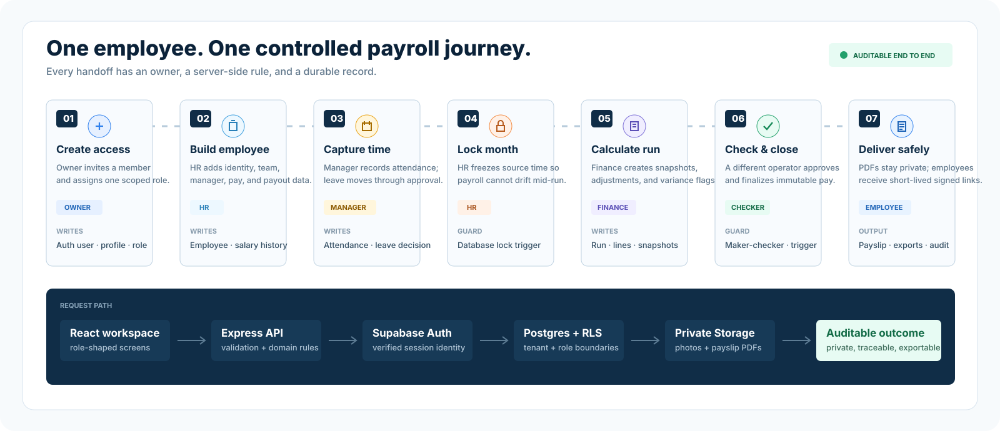
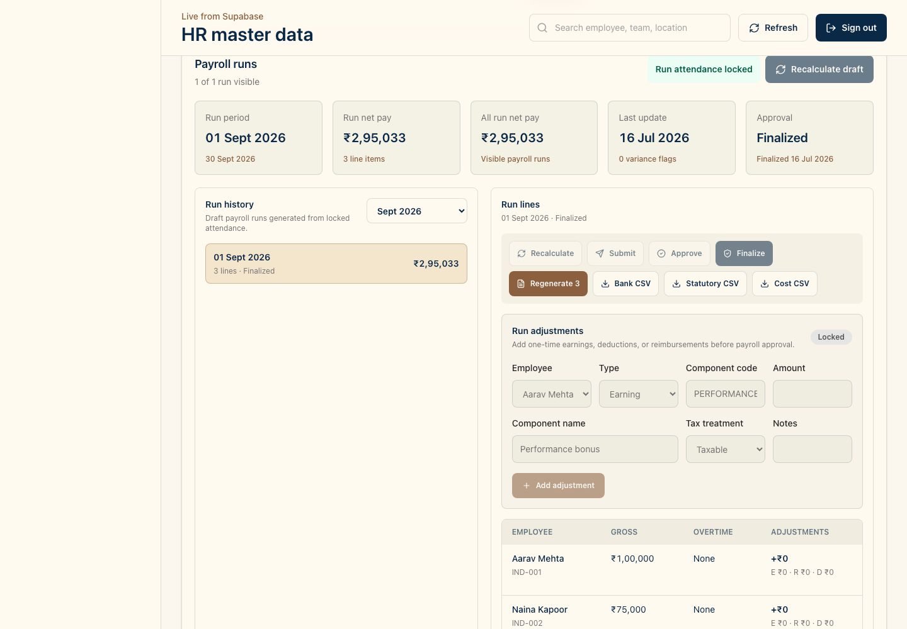
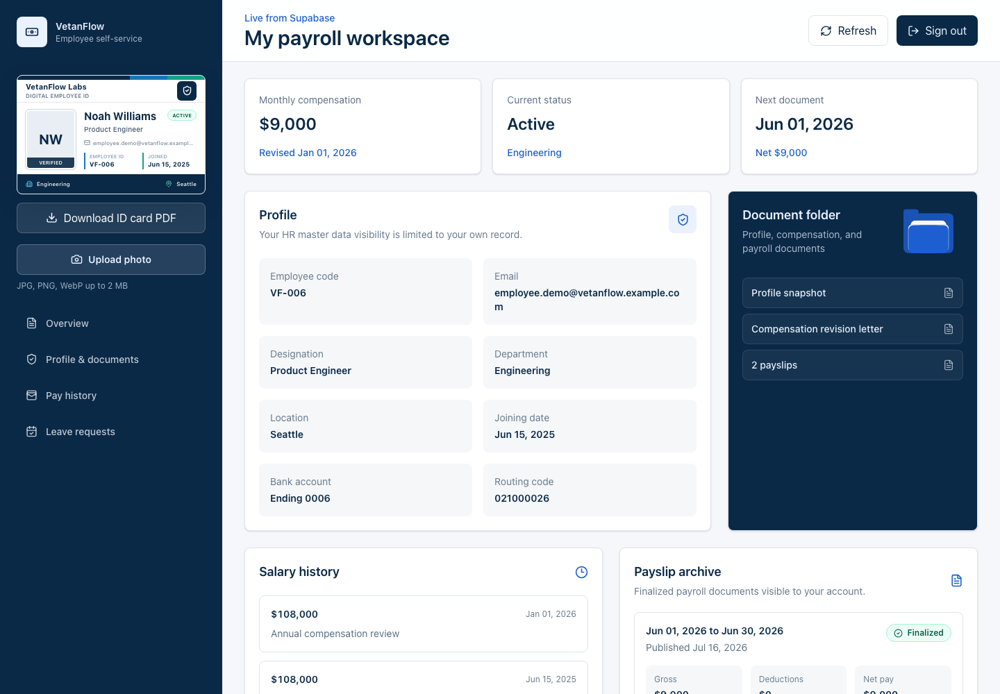
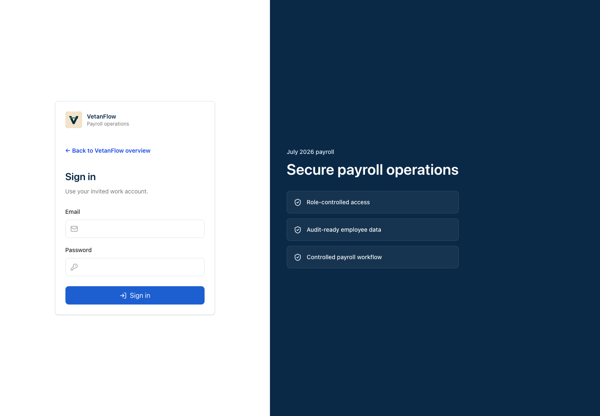
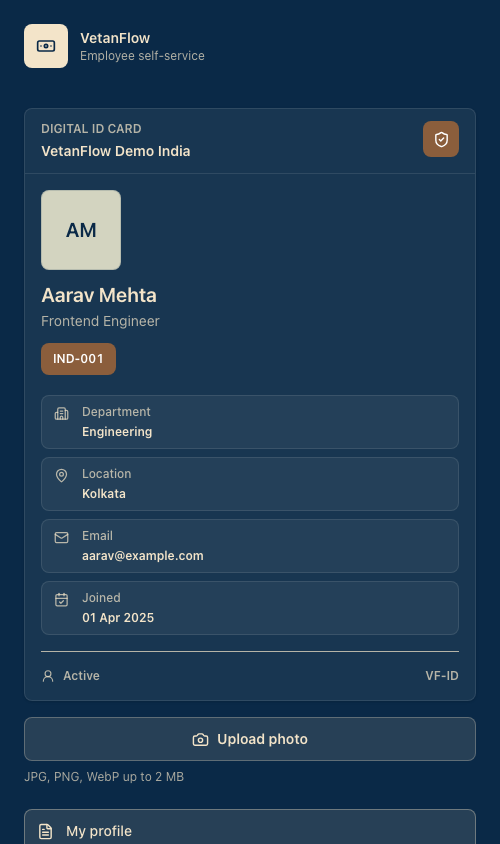
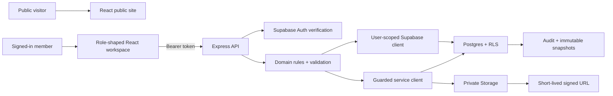
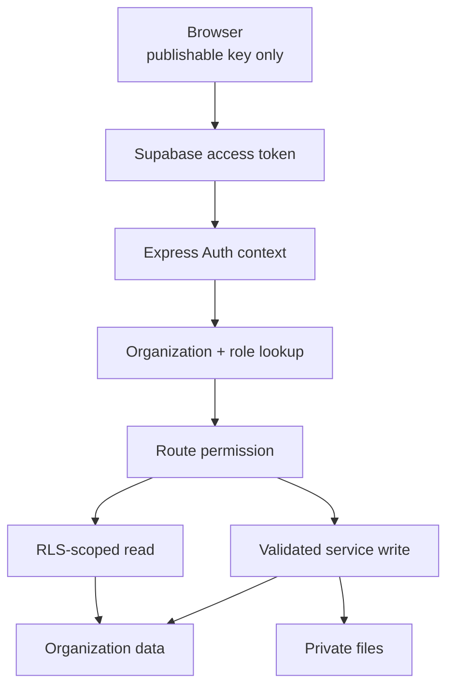
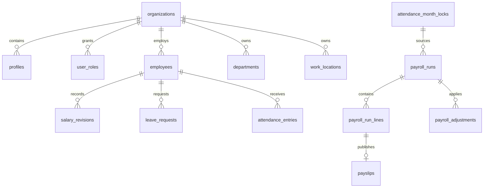

<p align="center">
  
</p>

<h1 align="center">VetanFlow</h1>

<p align="center">
  A role-based payroll operations platform built with React, Express, and Supabase.<br />
  It turns employee setup, time data, approvals, payroll, documents, and exports into one controlled monthly workflow.
</p>

<p align="center">
  
  
  
  
</p>

<p align="center">
  <a href="#start-here">Start here</a> ·
  <a href="#the-complete-journey">See the flow</a> ·
  <a href="#role-workspaces">Role access</a> ·
  <a href="#architecture">Architecture</a> ·
  <a href="#showcase-data">Run the showcase</a>
</p>

## What VetanFlow Is

For a guided presentation, run `npm run demo` and open [Demo workspaces](http://localhost:5173/demo). Choose a role, follow an employee through leave and payroll, and download the resulting documents. [The demo guide](docs/DEMO_GUIDE.md) covers accounts, setup, the five-minute story, and verification. `npm run demo:users` displays local credentials; passwords are never bundled into the frontend.

VetanFlow is a payroll control room for a growing organization. It does not treat payroll as an isolated calculator. It models the full path that makes a payroll result trustworthy:

- controlled user access and organization membership
- employee records, reporting lines, salary history, and payout readiness
- leave requests, manager/HR decisions, attendance, holidays, and month locks
- payroll calculation snapshots, adjustments, overtime, loss of pay, and variance warnings
- maker-checker approval, finalized-run immutability, and audit history
- private payslip PDFs, short-lived signed downloads, and finance exports
- different navigation, data visibility, and actions for every operational role

## Product Surfaces

| Route | Purpose |
| --- | --- |
| `/` | Public product landing page with real workspace previews |
| `/tour` | Animated, pausable employee-to-payslip walkthrough |
| `/how-it-works` | Product architecture, control model, and role flow |
| `/blog` | Product and payroll operations articles |
| `/terms` | Evaluation Terms of Service |
| `/privacy` | Privacy and data-handling summary |
| `/licenses` | Free evaluation terms and third-party open-source notices |
| `/login` | Sign-in plus explicit switching when a Supabase session already exists |
| `/demo` | Role picker with local presentation shortcuts and normal hosted sign-in |
| `/app` | Authenticated VetanFlow workspace |

The public site and secure workspace share one React application. `/login` owns account entry and switching; `/app` loads authenticated product workflows.

## The Complete Journey

<p align="center">
  
</p>

### 1. Create the organization member

An owner or permitted administrator invites a person. Supabase Auth owns the identity; `profiles` links that identity to one organization; `user_roles` gives it a scoped application role. The service-role key never enters the browser.

### 2. Create the employee record

HR creates the employee, selects department and work location, assigns a reporting manager, records compensation history, and adds payout details. An employee can be linked to an Auth profile without exposing compensation or bank fields through the direct Data API.

### 3. Capture leave and attendance

Employees request and cancel their own leave. Managers act on direct-report requests and can escalate cases to HR. HR maintains attendance, holidays, half days, absences, overtime, and the payroll-impact summary.

### 4. Lock the source month

The attendance month is locked before payroll begins. A database trigger rejects later attendance or holiday changes for that period, preventing source data from drifting after calculation.

### 5. Calculate payroll

Finance creates a run only from a locked month. VetanFlow calculates every active employee line, stores an immutable calculation snapshot, applies adjustments, and flags material changes against the previous run.

### 6. Review, approve, and finalize

The maker submits the draft. A different authorized operator must approve and finalize it. The backend enforces maker-checker separation, while Postgres triggers prevent edits to finalized runs, lines, and adjustments.

### 7. Publish private outputs

The backend generates one PDF per payroll line and uploads it to a private Supabase Storage bucket. Employees list only their own published payslips and receive a short-lived signed URL after an authorization check. Finance can also create bank, deductions, and department-cost CSV exports.

## Role Workspaces

VetanFlow has six application roles. They are not the same screen with disabled buttons; navigation, priorities, data scope, and action surfaces change with the job.

| Role | Primary workspace | Data scope | Key actions |
| --- | --- | --- | --- |
| Owner | organization command center | entire organization | access, settings, HR, payroll, approvals, exports |
| Admin | platform operations | entire organization | member operations, HR setup, workflow administration |
| HR | people operations | entire organization | employees, compensation history, leave, attendance, locks |
| Finance | payroll control | payroll-wide plus limited employee readiness | calculate, adjust, submit, approve/finalize, payslips, exports |
| Manager | team operations | self plus direct reports | team attendance, leave decisions, escalation, own payslips |
| Employee | personal self-service | own employee record | digital ID, leave request/history, own payslip archive |

`owner` is the highest organization role. VetanFlow deliberately has no hidden global superadmin in the application data model.

## Screenshots

| Owner workspace | Employee self-service |
| --- | --- |
|  |  |

| Sign in | Mobile employee page |
| --- | --- |
|  |  |

## Feature Map

| Domain | Implemented capability |
| --- | --- |
| Identity | Supabase Auth, Bearer-token verification, profiles, organization roles, invitation hierarchy |
| HR master data | employees, departments, locations, manager chains, salary revisions, private photos, archive/edit flows |
| Employee experience | distinct self-service workspace, digital ID, authorized two-sided ID PDF, leave, payslip archive, signed downloads |
| Leave | employee request/cancel, manager queue, approve/reject, HR escalation, decision metadata |
| Attendance | statuses, holidays, overtime, half-day/absence impact, summary, lock/unlock controls |
| Payroll | locked-month generation, snapshots, adjustments, variance, maker-checker, finalization guards |
| Documents | server-generated PDFs, private Storage, published records, signed URL delivery |
| Finance outputs | payout CSV, deductions CSV, department-cost CSV |
| Public product site | landing, tour, architecture, articles, Terms, Privacy, evaluation and OSS notices |
| Automation | 12-account cloud seed, six-month payroll bootstrap, readiness checks, role-login checks, screenshots, CI, deployment preflight |

## Architecture



### Responsibility boundaries

```txt
frontend/      React 19 + Vite, public product site, role workspaces, interaction state
backend/       Express 5 API, Auth context, repositories, payroll engine, PDF/CSV services
supabase/      Postgres schema, RLS, grants, triggers, private buckets, repeatable master seed
scripts/       cloud showcase provisioning, payroll bootstrap, login/readiness checks, screenshots
docs/          architecture, phases, walkthroughs, deployment, living handoff
graphify-out/  generated local code knowledge graph
```

The frontend never decides who may approve a run or which payslip a user may download. It can hide unavailable controls for usability, but the backend and database remain the authority.

## Security Model



Controls already present:

- service role key is backend-only and ignored by Git
- frontend contains only the publishable key
- all public tables use RLS and explicit grants
- sensitive compensation and payout columns are not directly granted to ordinary authenticated clients
- roles are organization-scoped and resolved server-side
- employees and managers have row-level visibility boundaries
- payroll requires a locked source month
- maker and checker must be different users
- finalized payroll data rejects mutation at the database layer
- payslips and employee photos use private Storage buckets
- signed payslip links are issued only after an access check
- seed credentials are written to ignored local storage with mode `0600`
- candidate logins are checked by the API before replacing the browser session; failed sign-in preserves the current account
- stale data responses cannot restore the previous account's workspace
- owner can export any organization employee ID; employees receive `404` for cross-record ID requests
- API input and route identifiers are validated with Zod
- Helmet, payload limits, restricted CORS, and API/invitation rate limits are active
- API responses use `Cache-Control: no-store`; CI checks credentials, Git history, and dependency advisories
- Sentry browser/server capture remains opt-in through deployment DSNs and does not enable default PII collection

No software can honestly promise zero vulnerabilities. This project uses layered controls and automated checks; a real commercial launch should still include independent penetration testing, privacy/legal review, production secret rotation, backups, monitoring, and an incident-response process.

## Data Model



## Start Here

### Prerequisites

- Node.js 22 or newer; `.nvmrc` targets Node 24
- npm
- a Supabase Cloud project
- Supabase CLI for schema linking/push

### 1. Install and configure

```sh
npm install
cp backend/.env.example backend/.env
cp frontend/.env.example frontend/.env
```

Backend-only:

```txt
SUPABASE_URL
SUPABASE_PUBLISHABLE_KEY
SUPABASE_SERVICE_ROLE_KEY
CORS_ORIGIN
```

Frontend-safe:

```txt
VITE_API_BASE_URL
VITE_SUPABASE_URL
VITE_SUPABASE_PUBLISHABLE_KEY
```

Never place `SUPABASE_SERVICE_ROLE_KEY` in `frontend/.env`, a `VITE_*` variable, source code, screenshots, or documentation.

### 2. Link the database

```sh
npm run supabase:link -- --project-ref <project-ref>
npm run supabase:push
npm run supabase:types
```

### 3. Build the complete showcase

```sh
npm run demo:bootstrap
```

The bootstrap is repeatable. It creates or updates 12 role accounts, seeds the organization and operational records, prepares the previous six closed payroll months, generates payslips, then checks readiness and every login.

On first run, it requests the owner password without echoing it. Role credentials are saved only to:

```txt
.tmp/demo-credentials.json
```

That file is Git-ignored and written with local owner-only permissions. Do not use these showcase credentials in a public production environment.

### 4. Run the product

```sh
npm run dev
```

- public site: `http://localhost:5173/`
- sign in/account switcher: `http://localhost:5173/login`
- secure workspace: `http://localhost:5173/app`
- API health: `http://localhost:4000/health`

Vite selects the next free port when `5173` is already in use. Add that origin to backend `CORS_ORIGIN` when testing authenticated API calls from the alternate port.

## Showcase Data

The live-ready showcase contains:

- 1 organization configured for India, INR, en-IN, and Asia/Kolkata
- 12 linked Auth users: 1 owner, 2 admins, 2 HR, 2 finance, 2 managers, 3 employees
- 24 Indian employees across 5 departments and 4 Indian offices
- active, leave, exit-pending, and draft employee states
- reporting lines for leadership and manager direct reports
- payout-ready employees and compensation revision history
- pending, escalated, approved, rejected, and cancelled leave examples
- current attendance with present, half-day, absent, and overtime examples
- six recent historical locked payroll months plus three retained older sample periods
- 198 finalized INR payroll lines and published payslips, with 6,270 attendance records and 24 leave examples
- seeded audit events and organization preferences

Useful commands:

```sh
npm run demo:seed-showcase   # Auth users + operational foundation
npm run demo:prepare         # previous calendar month by default
npm run demo:check           # 15 readiness assertions
npm run demo:check-logins    # signs in every role and verifies API visibility
npm run demo:bootstrap       # all of the above plus six historical months
```

## How To Demonstrate The Product

1. Open `/` and use the product tour to establish the workflow.
2. Sign in as owner and show organization health, people readiness, access controls, and any-employee ID PDF authority.
3. Switch to HR and show employee master data, salary history, leave, attendance, and locking.
4. Switch to manager and show the reduced direct-report scope and leave queue.
5. Switch to finance and open the older run for variance, then the latest finalized run and exports.
6. Switch to employee and show the personal digital ID, leave history, and private payslip download.
7. Explain that UI permissions improve usability, while API checks, RLS, grants, and triggers enforce security.

Detailed scripts:

1. [Demo walkthrough](docs/DEMO_WALKTHROUGH.md)
2. [Recorded demo script](docs/RECORDED_DEMO_SCRIPT.md)
3. [Demo reset checklist](docs/DEMO_RESET_CHECKLIST.md)
4. [Screenshot guide](docs/SCREENSHOT_GUIDE.md)
5. [Deployment guide](docs/DEPLOYMENT.md)

## Quality Gates

```sh
npm run verify
npm run security:check -- --history
npm audit --audit-level=moderate
npm run deploy:check
npm run demo:check
npm run demo:check-logins
```

`npm run verify` scans push candidates and browser build assets for secrets, runs frontend/backend linting and strict typechecks, executes the scanner/backend/frontend tests, and builds both workspaces. CI also scans reachable Git history and audits dependencies. Local known credentials are compared without printing their values; CI performs format-based checks without production credentials.

October 20 push-preparation verification: 103 tests (94 backend, 5 frontend, 4 secret-scanner checks), lint/typechecks/builds, 15/15 readiness checks, 12/12 live role accounts, and zero npm dependency advisories. The fresh Supabase security advisor reports one warning: leaked-password protection is disabled. Performance advice contains informational unused-index notices only. See [the release/security check](docs/RELEASE_READINESS.md) and [the earlier usability audit](docs/DEMO_USABILITY_AUDIT.md). Push readiness is not a certification for handling real payroll.

## Deployment Shape

| Layer | Target |
| --- | --- |
| Frontend/API | preferred same-origin Vercel deployment using `api/[...path].ts` |
| Backend alternative | Render-compatible Node service through `render.yaml` |
| Data | Supabase Cloud Postgres, Auth, RLS, and Storage |
| CI | GitHub Actions |

Production launch work still includes custom domains, monitored email delivery, secret rotation, rate-limit tuning, backups, observability, legal documents for the operating company, and independent security review.

## Phase Story

| Phase | Status | Result |
| --- | --- | --- |
| 0 | Complete | React/Express/Supabase foundation, tests, CI, docs |
| 1 | Complete | cloud database, Auth, RLS, role-aware API |
| 2 | Complete | HR master data, compensation, photos, digital ID, self-service |
| 3 | Complete | leave workflow, attendance, holidays, period locks |
| 4 | Complete | payroll engine, adjustments, variance, maker-checker, immutability |
| 5 | Complete | payslip PDFs, private delivery, bank/deduction/cost exports |
| 6 | Complete | demo reset, screenshots, deployment preparation |
| 7 | Complete | global terminology, role-specific UX, settings, access hierarchy, hardening |
| 8 | Complete | public product site, animated tour, full showcase data, role accounts, study flow |
| 9 | Complete | account switching, owner ID authority, six-month data, settings controls, Sentry, branding, hardening, documentation |
| 10 | Complete | simpler workspaces, real onboarding links, INR sample-history rebuild, reconciliation, role/browser verification |

Full tracker: [docs/PHASES.md](docs/PHASES.md)

## Study Path

Read in this order:

1. This README for product intent and the full journey.
2. [docs/ARCHITECTURE.md](docs/ARCHITECTURE.md) for runtime and trust boundaries.
3. [docs/AI_TAKEOVER.md](docs/AI_TAKEOVER.md) for the exact current resume point and non-negotiable rules.
4. [docs/HANDOFF.md](docs/HANDOFF.md) for the concise current implementation state and next target.
5. [supabase/migrations](supabase/migrations) for schema, grants, RLS, and trigger evolution.
6. [backend/src/modules/payroll](backend/src/modules/payroll) for payroll calculation and document generation.
7. [backend/src/modules/auth](backend/src/modules/auth) for identity and role resolution.
8. [frontend/src/public-site](frontend/src/public-site) for the public product experience.
9. [frontend/src/App.tsx](frontend/src/App.tsx) for the authenticated workspace.
10. [scripts/seed-showcase-data.ts](scripts/seed-showcase-data.ts) and [scripts/bootstrap-showcase.mjs](scripts/bootstrap-showcase.mjs) for live automation.

## Licensing

The repository does not currently grant a general open-source license for VetanFlow itself. The public `/licenses` page documents evaluation terms and the licenses of included third-party packages. Add a reviewed commercial or source license before distributing the product beyond private evaluation.

---

<p align="center">
  <strong>VetanFlow</strong><br />
  People data in. Controlled payroll out.
</p>
