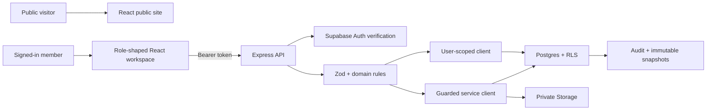
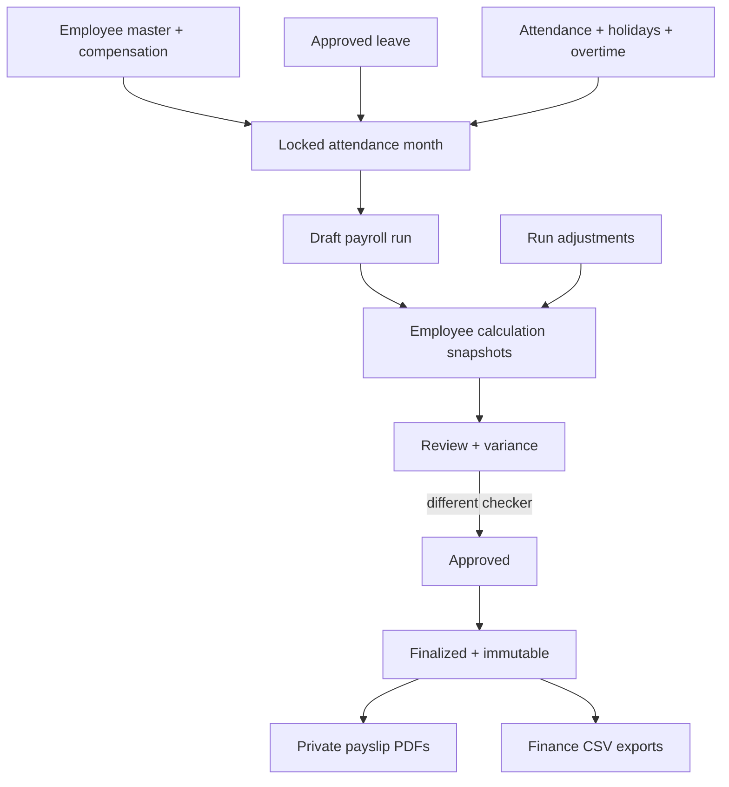
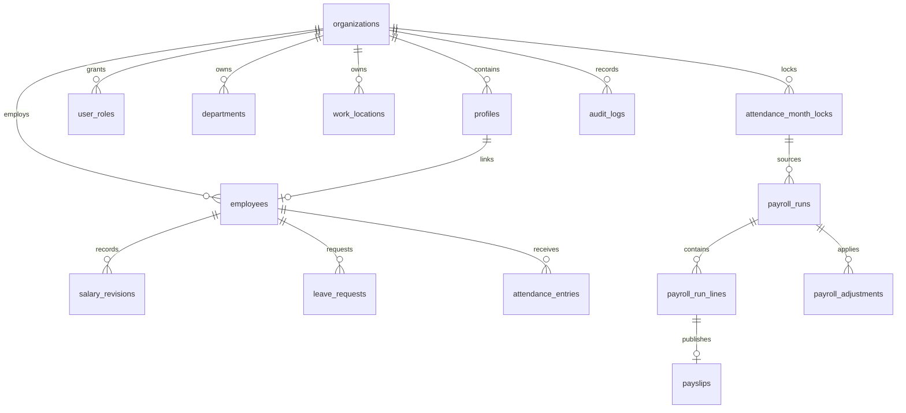

# Architecture

VetanFlow is a role-based payroll operations system with a React interface, an Express authority layer, and Supabase for identity, data, security policies, and private files.

## Runtime Shape



Local development uses two processes through `npm run dev`:

- Vite serves the frontend on `5173` or the next free port.
- Express serves the API on `4000`.

The compact production shape uses one Vercel project:

- Vercel serves `frontend/dist`.
- `/api/*` rewrites to `api/[...path].ts`.
- The function exports the same Express app used by the standalone server.

`render.yaml` remains an alternative standalone backend deployment.

## Responsibility Boundaries

| Layer | Owns | Must not own |
| --- | --- | --- |
| React | navigation, forms, loading, responsive presentation, role-specific UX | authorization, role assignment, payroll truth |
| Express | token verification, tenant/role resolution, validation, business rules, PDFs, CSVs | long-term data or browser session persistence |
| Supabase Auth | user identity and sessions | application role selection |
| Postgres | tenant records, RLS, privileges, locks, immutable payroll state | visual workflow state |
| Storage | private employee photos and payslip PDFs | public permanent payroll links |
| Sentry | optional operational error/tracing telemetry | payroll source data or secrets |

The browser receives only a Supabase publishable key. The service-role key stays in backend/serverless environments and trusted scripts.

## Identity And Roles

```text
auth.users
  -> profiles (user + organization)
  -> user_roles (organization-scoped role)
  -> employees.profile_id (optional self-service link)
```

Roles are `owner`, `admin`, `hr`, `finance`, `manager`, and `employee`. Owner is the highest organization role. Users never select a role during signup.

The backend constructs an Auth context from the Bearer token, profile, organization, and roles. Repositories then choose one of two database paths:

- user-scoped Supabase client for RLS-filtered reads
- service client for validated, explicitly authorized writes and sensitive reads

Frontend navigation mirrors the role model but is never treated as a security boundary.

## Account Routing

Public routes render without an Auth requirement. `/login` handles both new sign-in and persisted sessions:

1. No session: show email/password sign-in.
2. Existing session: show the current email with Continue or Use another account.
3. Use another account: local-scope sign-out, then clean sign-in.
4. Password sign-in uses an isolated, nonpersistent Auth client. `/api/auth/workspace` verifies that candidate token and resolves the exact user's organization and roles before installing the shared browser session.
5. Failed password or workspace validation leaves an existing valid session unchanged. Old unassigned `.test` identities return `403`, never an assumed role.
6. `/app` renders only master data belonging to the current session. Token/request-version guards discard stale responses from earlier accounts; newer Auth events take priority over initial session restoration.

This prevents a stored owner session from silently redirecting every attempted login back to the owner workspace.

All `/api` responses use `Cache-Control: no-store`. A stored browser session is shared across tabs, so switching accounts in one tab changes the active identity in the others. Use separate browser profiles for simultaneous independent accounts.

## Core Domains

### Organization And Access

- organization name, country, currency, locale, timezone
- profiles and organization membership
- hierarchy-safe invitations and role assignment
- audit trail

### HR Master Data

- departments and work locations
- employees, status, reporting manager, photo, and payment readiness
- compensation revision history
- digital and downloadable two-sided employee ID cards

### Leave And Attendance

- employee leave request and cancellation
- manager/HR decision and escalation
- attendance status, half day, absence, overtime, holidays
- payroll-impact summary
- source-month lock and database trigger protection

### Payroll

- draft creation only from a locked attendance month
- calculation snapshots and previous-run variance
- earnings, deductions, reimbursements, and overtime adjustments
- `draft -> reviewing -> approved -> finalized`
- maker-checker separation
- finalized-run, line, and adjustment immutability

### Documents And Exports

- finalized-run payslip PDF generation
- private Storage upload and database publication record
- RLS-backed signed payslip delivery
- payout, deductions, and department-cost CSV exports
- employee ID PDF export with role and row-scope checks

## Payroll Data Flow



The frontend does not calculate authoritative payroll. `calculate-payroll.ts` and `payroll-run-repository.ts` run on the backend, and the resulting values are stored in line snapshots for future explanation.

## Data Model



The chronological migration set in `supabase/migrations/` is the schema source of truth. `backend/src/lib/database.types.ts` is generated from the linked schema.

## Security Layers

1. **Configuration:** production fails fast without Supabase credentials or explicit trusted CORS origins.
2. **HTTP:** Helmet, JSON-size limit, API rate limit, invitation-specific rate limit, generic 500 response.
3. **Identity:** Supabase verifies the access token; the backend resolves profile, organization, and roles.
4. **Validation:** Zod validates environment variables, route identifiers, query parameters, and request bodies.
5. **Authorization:** routes and repositories enforce role and row scope.
6. **Privileges:** `anon` has no public-table privileges; authenticated grants are least privilege.
7. **RLS:** organization, manager, and employee visibility rules filter direct Data API reads.
8. **Sensitive columns:** compensation and payment columns are not broadly granted to authenticated clients.
9. **Database invariants:** lock/finalization triggers reject prohibited changes even from privileged code.
10. **Private files:** photos and payslips use private buckets; payslip links are short-lived and access checked.
11. **Audit:** pay-impacting and lifecycle operations write audit records.
12. **Monitoring:** Sentry is optional and configured without default PII collection.

## Organization Formatting Flow

Country, currency, locale, and timezone are selected from curated options. The backend validates the saved values. They then affect:

- currency rendering in the workspace and documents
- localized dates on payslips and employee IDs
- organization identity in generated documents
- reporting-cutoff and local-time previews
- default behavior when the country selection changes

These preferences are operational configuration, not decorative profile fields.

## Deployment Choices

### Preferred: Vercel Plus Supabase

The frontend and Express API deploy from one repository and domain. Same-origin `/api` calls avoid a separate production CORS hop.

### Alternative: Vercel, Render, And Supabase

Vercel serves the frontend; Render runs the compiled Express server. This preserves a long-running Node service and requires explicit cross-origin configuration.

See `docs/DEPLOYMENT.md` for environment variables and smoke tests.

## Extension Rules

- Add country-specific compliance as separate tested policy modules, not conditionals spread through UI and repositories.
- Add new write paths through a route schema, explicit role rule, repository method, audit event, and focused tests.
- Add database fields through migrations, then regenerate types.
- Preserve immutable payroll snapshots when changing calculations.
- Keep public marketing routes and authenticated operational routes visually related but structurally separate.
- Prefer splitting `App.tsx` by established domain boundaries when the next substantial feature is added; do not perform a risky rewrite only for aesthetics.
